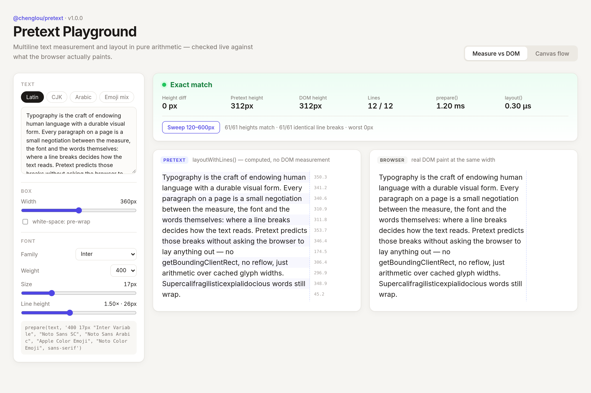
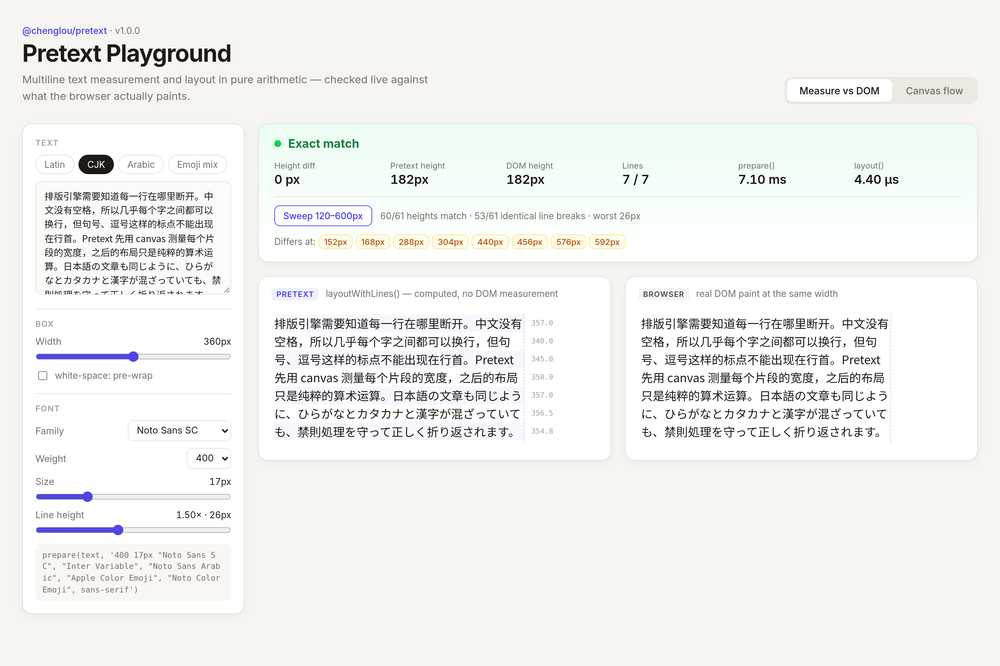
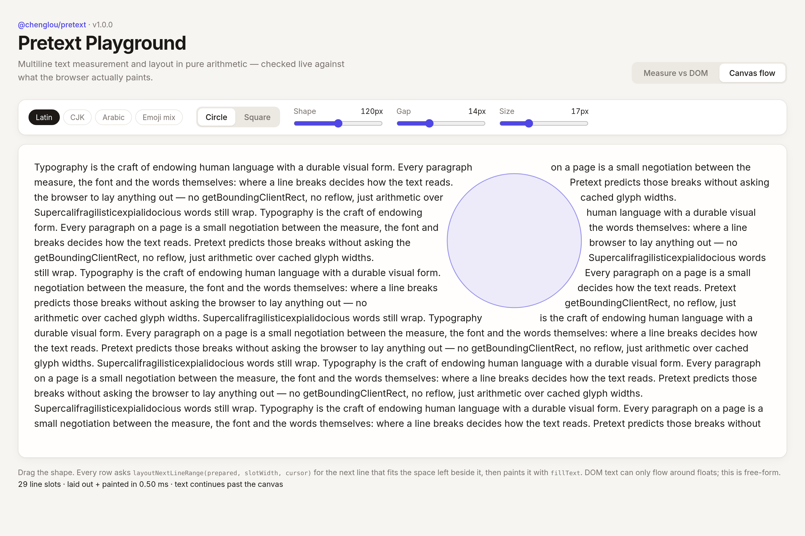

# pretext-playground

A small playground for **[Pretext](https://github.com/chenglou/pretext)** by Cheng Lou (`@chenglou/pretext` v1.0.0): multiline text measurement and layout in pure JavaScript, without DOM reflow.

Bookmark: [YousufSoomroDev on X](https://x.com/YousufSoomroDev/status/2073713632517754950).

```sh
bun install
bun run dev      # http://localhost:5173
bun run build    # tsc -b && vite build
```

## Tabs

**Measure vs DOM** (`#measure`): pick a preset (Latin, CJK, Arabic, Emoji mix) or type your own text, then drag the width and font controls. The left pane is Pretext's `prepareWithSegments()` + `layoutWithLines()` output, line by line with each line's measured width. The right pane is the browser painting the same text at the same width. The banner shows the height difference in px, line counts on each side, and `prepare()` / `layout()` timings. **Sweep** checks every 8px from 120 to 600px and lists any widths where heights or line breaks differ; click one to jump to it.

The DOM's line breaks are read back from per-grapheme client rects only to verify Pretext. Pretext itself never measures the DOM.

**Canvas flow** (`#flow`): text streams around a draggable circle or square. Each row is split into the slots left and right of the shape, and each slot asks `layoutNextLineRange(prepared, slotWidth, cursor)` for the next line, then `materializeLineRange()` + `fillText()`.

## Fonts

All faces are bundled so measurements match across machines: Inter Variable, Noto Sans SC, Noto Sans Arabic (via @fontsource) and Noto Color Emoji (COLRv1, self-hosted in `public/fonts/`, SIL OFL 1.1). On macOS, Apple Color Emoji is used first. Text is prepared only after `document.fonts.load()` resolves, and Pretext's cache is cleared after each load.

## Results seen in headless Chromium (Linux, 1440×960 @2x)

At the default 360px / 17px / 26px line height, all four presets show **0 px** height difference. Sweep (61 widths):

| Preset | Heights match | Identical line breaks | Worst diff |
| --- | --- | --- | --- |
| Latin | 61/61 | 61/61 | 0px |
| CJK | 60/61 | 53/61 | 26px (one line) |
| Arabic | 61/61 | 61/61 | 0px |
| Emoji mix | 61/61 | 61/61 | 0px |

The CJK differences are all in the Japanese sentence: at 8 widths Chromium fits one more character on the line than Pretext does, around `、`.

## Screenshots





Video: [docs/pretext-playground-demo.mp4](docs/pretext-playground-demo.mp4)
