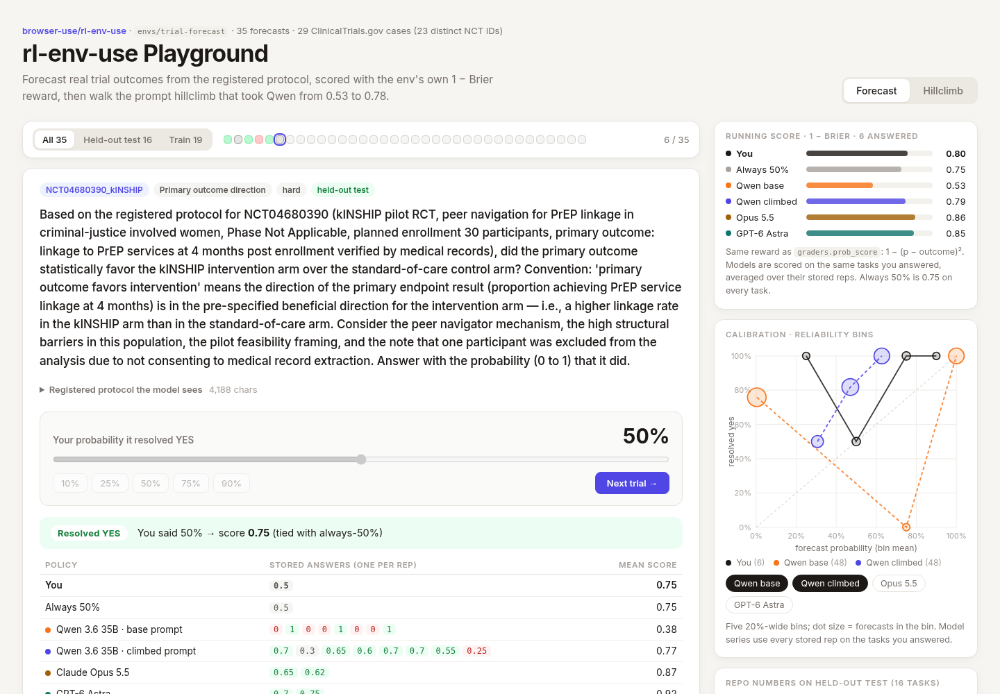
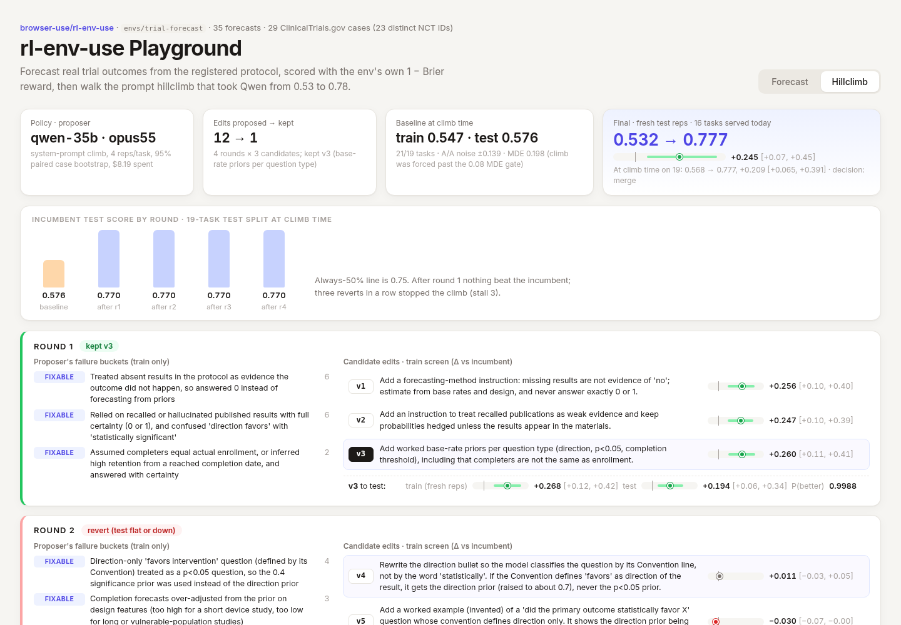

# rl-env-use Playground

A no-keys playground for [browser-use/rl-env-use](https://github.com/browser-use/rl-env-use) (MIT, open-sourced 21 Oct 2026), built on its shipped example env [`envs/trial-forecast`](https://github.com/browser-use/rl-env-use/tree/92fe423137c01178692bf0a26c769b20438f9c5f/envs/trial-forecast): 35 yes/no forecasts about ClinicalTrials.gov trials whose results were posted after July 2026.

```bash
bun install && bun run dev
```




Video: [docs/rl-env-use-playground-demo.mp4](docs/rl-env-use-playground-demo.mp4)

## Tabs

**Forecast:** step through the 35 tasks the env serves today, held-out test split first. Read the registered protocol (the exact `context` the policy sees), set a probability, and lock it in. The reveal shows the gold, your score, and every stored rep from four models. You get a running scoreboard against always-50% and a reliability-bin calibration chart.

**Hillclimb:** the four rounds from `climb-qwen-35b/_state.json`. Each round shows the proposer's failure buckets (train only), three candidate edits with train-screen paired CIs, the chosen edit's train and test CIs, and keep/revert. A diff shows each variant's system-prompt extension against its parent.

## Scoring

Same reward as `rl_env_use/graders.py` `prob_score`: **1 − (p − outcome)²**, with yes = 1 and no = 0. Always answering 0.5 scores 0.75 on every task. A model's per-task score is its mean over stored reps, as in `audit.case_means`.

## Numbers shown (all from repo artifacts; none invented)

| What | Value | Source |
|---|---|---|
| Tasks / case keys / distinct NCT IDs | 35 / 29 / 23 | `tasks.jsonl` through the repo's `keep()`+`balanced()` (= `Env(env_dir)`), `audit.json`, `stats.json` |
| Gold yes / no | 21 / 14 | `tasks.jsonl`, `stats.json` |
| Climb, fresh test reps, 16 tasks served | 0.532 → 0.777, +0.245 [+0.066, +0.451] | recomputed with `audit.paired` on reps 4–7, matches `stats.json` and README |
| Climb at climb time (19 test tasks) | 0.568 → 0.777, +0.209 [+0.065, +0.391], merge | `_state.json` `final` |
| Edits proposed / kept | 12 / 1 (v3, base-rate priors per question type) | `_state.json` `rounds` |
| Baseline at climb | train 0.547, test 0.576, noise ±0.139, MDE 0.198 (forced past the 0.08 gate) | `_state.json`, `stats.json` |
| Held-out test (16), mean over stored reps | Opus 5.5 0.771 · GPT-6 Astra 0.813 · base Qwen 0.551 · climbed Qwen 0.770 | `models/v2`, `models/v3`, `climb-qwen-35b/{baseline,v3}/results.jsonl` |
| Climb spend | $8.19 | `_state.json` `usd` |

## Caveats

- **Climbed Qwen on train tasks is in-sample.** The proposer read Qwen's failures there. The UI labels each task's split.
- **Two denominators.** The rounds were recorded on a 40-task split (21 train / 19 test). A stricter critic later dropped 5 tasks. Round CIs are shown verbatim at 21/19, and the hero final is regraded on the 16 served test tasks.
- **Split by case key, not by trial.** NCT04316715, NCT04592978 and NCT04680390 each appear under two case keys with tasks on both sides of the split.
- **What's not in the repo:** per-rep reasoning traces (`traces/` isn't shipped). The reveal shows only stored answers.
- Base Qwen in the Forecast tab is the climb's baseline run: 4 reps on train tasks and 8 on test tasks. The `models/baseline` 2-rep run (0.599 on all 35) isn't used.

## Optional: build your own env (not wired, off by default)

The playground never calls a model. To mine a new env you need a Browser Use and an OpenRouter key and to run the upstream CLI yourself:

```bash
git clone https://github.com/browser-use/rl-env-use && cd rl-env-use
uv venv && uv pip install -e .
cp .env.example .env   # BROWSER_USE_API_KEY, OPENROUTER_API_KEY
rl-env-use create "predict whether a completed trial met its primary endpoint from its registered protocol; ClinicalTrials.gov" --budget 40
rl-env-use climb envs/<name> --model qwen-35b
```

The upstream README reports the shipped env cost $72 to build, $17 of it Browser Use.

## Refreshing the data

```bash
cd rl-env-use && uv venv && uv pip install -e .
.venv/bin/python <this-app>/scripts/extract.py . <this-app>/src/data
```

## Attribution

Task text, protocol excerpts, gold answers, model answers, climb state and prompts are © 2026 Browser Use, MIT-licensed, vendored from commit `92fe423`. See [`src/data/LICENSE-rl-env-use.txt`](src/data/LICENSE-rl-env-use.txt). Protocol and results text originates from ClinicalTrials.gov.
